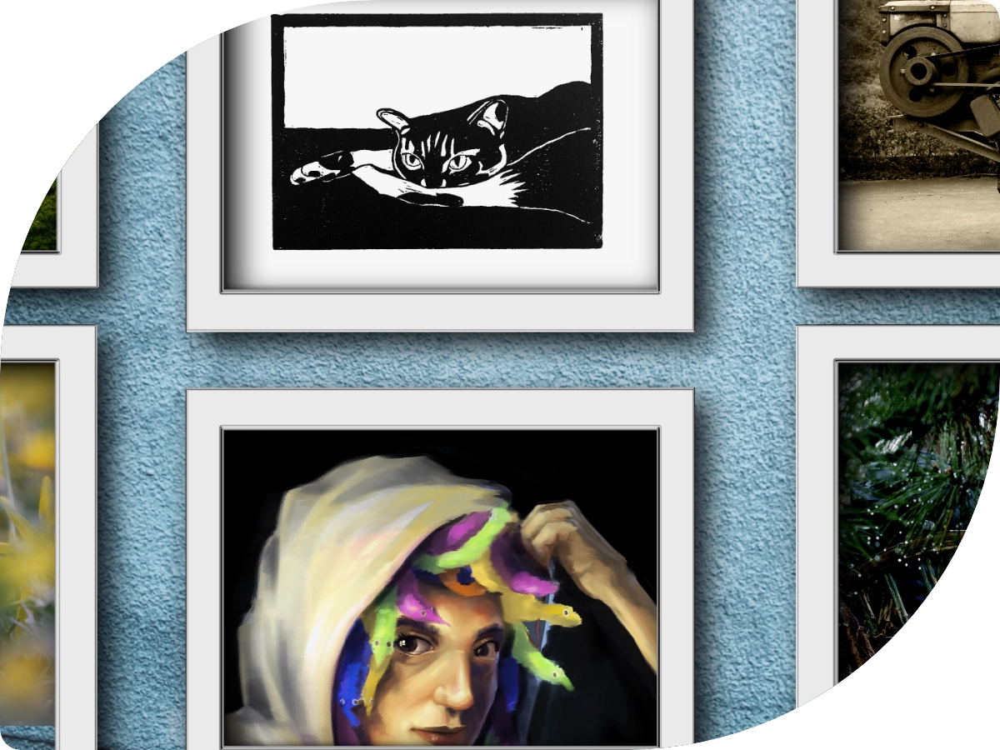
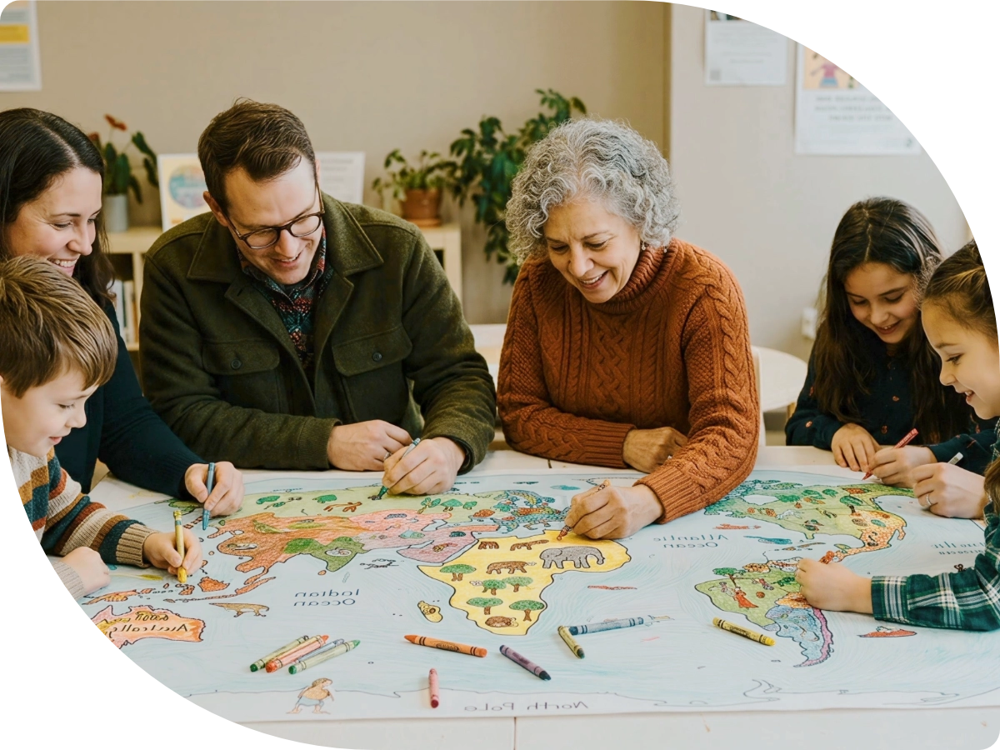

{}
{}

{}
{}
#### If You Can Dream It, We Can Design It.
We provide design services in magazines, brochures, posters, business cards, stickers & vinyl, booklets, flyers, website banners, online advertisements, and social media posts.
{}
{}

{}

{}
#### Buy and Sell Art
We represent artists while providing them with ***fair revenue***. We believe in ***equal marketing*** opportunities between all represented artists.\
\
We maintain ***professional catalogues*** for tracking artwork and uphold a ***high standard*** of ***quality control*** for our collectors.
{}
{}

{}
{}

{}
{}

{}

{}
#### Buy and Sell Art
We represent artists while providing them with ***fair revenue***. We believe in ***equal marketing*** opportunities between all represented artists.\
\
We maintain ***professional catalogues*** for tracking artwork and uphold a ***high standard*** of ***quality control*** for our collectors.
{}

{}

{}
{}

{}
{}
#### DIY Arts and Crafts
We manufacture, print, and assemble DIY art kits by hand, creating ***unique products*** that are made with ***love and care*** from start to finish.\
\
***Sustainability and Eco-conscious decisions*** are heavily integrated into our production line.\
\
When you purchase from our online store, ***proceeds are used*** to ***donate art supplies*** to marginalized communities, such as: Disabled veterans, children in protective custody, those impacted by homelessness, individuals with mental and physical illness or injury.\
\
Art is an amazing tool that has ***heaing effects*** and ***brings people together***.\
\
***Community and well being through art*** should be available to all.
{}
{}